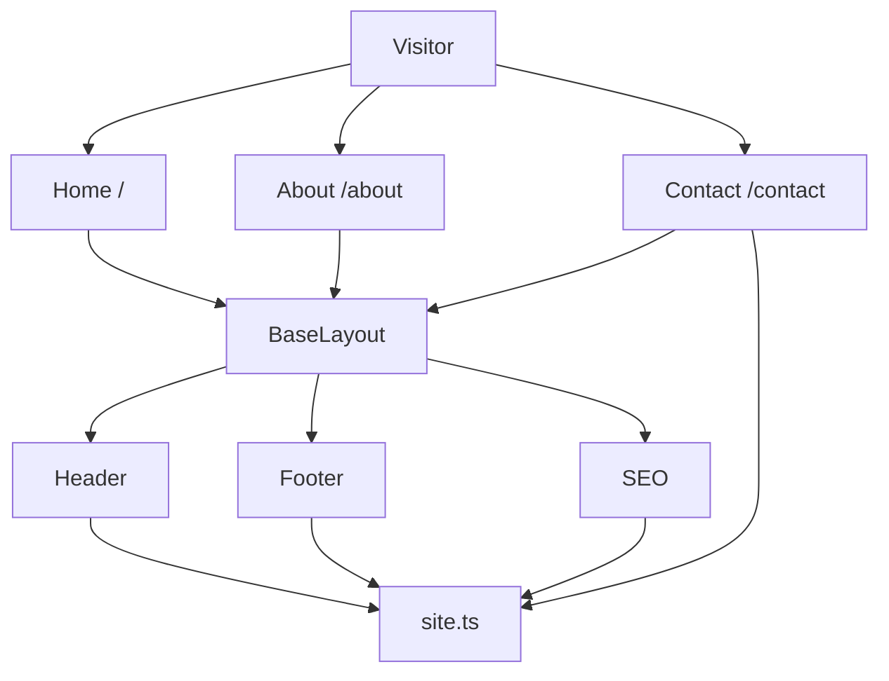

# Personal Website

A fast, modern personal website built with [Astro](https://astro.build).

## Pages

- **Home** — intro and call to action
- **About** — bio, skills, experience
- **Contact** — email and social links



## Getting started

```bash
npm install
npm run dev
```

Open [http://localhost:4321](http://localhost:4321) in your browser.